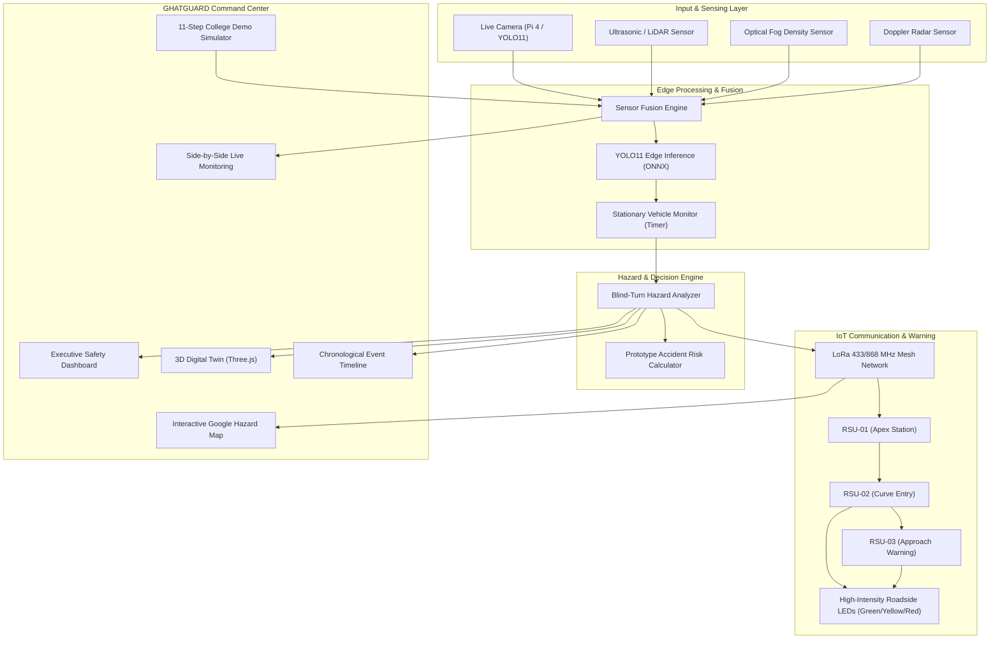

# GHATGUARD: Intelligent Fog Detection & Accident Prevention System for Ghat Roads
## Implementation Plan & Architecture Specification

### 1. Executive Summary & Core Concept
**GHATGUARD** is an edge-native IoT and AI safety monitoring platform engineered specifically for dangerous mountain ghat corridors, hairpin curves, and dense fog environments.
- **Core Principle**: **DETECT ➔ UNDERSTAND ➔ COMMUNICATE ➔ WARN**
- **Philosophy**: *"Do not wait for the driver to see the danger. Detect the danger early and communicate it in advance."*
- **Edge Deployment**: Raspberry Pi 4 running YOLO11 ONNX (`http://raspberry.local:8080/stream.mjpg`) + Ultrasonic distance sensor / audio frequency telemetry + LoRa mesh (RSU-01, RSU-02, RSU-03) + Roadside warning LED strobes.

---

### 2. Architecture & Data Flow

---

### 3. Detailed Component Plan

1. **Backend API Enhancements (`backend/app/api/routes.py` & `backend/app/database/db.py`)**:
   - `GET /api/status`: System state (SAFE / CAUTION / HAZARD), visibility %, fog status, active hazards, connected RSUs.
   - `GET /api/fog`: Real-time optical fog density, visibility index, meteorological status.
   - `GET /api/vehicles`: Tracked vehicles, stationary status, stopped duration, lane, coordinates.
   - `GET /api/hazards`: Active blind-turn hazards, conflict zones, distance to apex.
   - `GET /api/sensors`: Ultrasonic distance (m), LiDAR, radar, audio frequency sonar data, optical fog.
   - `GET /api/roadside-units`: RSU-01, RSU-02, RSU-03 states, LED signals (GREEN/YELLOW/RED), LoRa RSSI, solar battery.
   - `GET /api/events`: Complete event history audit feed with timestamps and severity.
   - `POST /api/simulation/...`: Endpoints for fog, vehicle injection, stationary hazard, and reset.
   - Preserve existing stream proxy, check, and camera endpoints!

2. **Frontend Type System & Services (`frontend/src/types/index.ts` & `frontend/src/services/`)**:
   - Define types for `FogState`, `RoadsideUnit`, `LoRaPacket`, `SensorReading`, `StationaryVehicle`, `RiskBreakdown`, `GhatEvent`, `SimulationStep`.
   - Build unified `simulationService.ts` providing synchronized real-time state with local reactivity and backend sync.

3. **Navigation & Global Command Bar (`frontend/src/components/Sidebar.tsx` & `Header.tsx`)**:
   - Brand: **GHATGUARD** with animated radar shield logo.
   - 8 Navigation Views:
     1. **Dashboard** (Command Center Hero, Fog Gauge, Stationary Vehicle Monitor, Hazard Engine, LEDs, Sensors, Edge AI sparkline).
     2. **Live Monitoring** (Side-by-Side Dual View: Live Raspberry Pi webcam + Google Map + YOLO boxes + Ultrasonic distance).
     3. **Hazard Map** (Google Map + RSU units + animated LoRa packet propagation lines).
     4. **3D Digital Twin** (Three.js mountain ghat hairpin curve with dynamic fog, moving vehicles, stalled vehicle, roadside LEDs).
     5. **Detection** (YOLO11 Edge AI Studio + Stationary Vehicle Monitor with timer).
     6. **Events** (Real-time chronological incident timeline).
     7. **System Health** (Hardware, Edge Pi, Sensors, LoRa, Power/Solar/Battery).
     8. **Simulation** (11-Step College Demo Runner with 1-click progression and manual sliders).

4. **Dedicated Components**:
   - `HeroStatusArea.tsx`: High-impact status banner (SAFE / CAUTION / HAZARD, Visibility %, Fog Density, Units).
   - `FogVisibilityPanel.tsx`: Interactive circular/arc gauge with real-time Fog Density slider (0-100%).
   - `HazardPipelineView.tsx`: Animated multi-stage detection pipeline (`Sensors ➔ Fusion ➔ Edge AI ➔ Detection ➔ Decision`).
   - `StalledVehicleMonitor.tsx`: Stationary vehicle telemetry card with ticking timer, threshold selector (10s, 20s, 30s, 60s), and hazard trigger.
   - `AccidentRiskAnalysis.tsx`: Prototype Risk Score (0-100) with weighted factors breakdown.
   - `RoadsideWarningSystem.tsx`: Physical RSU-01, RSU-02, RSU-03 visualization with animated LED lights (Green/Yellow/Red).
   - `LoRaCommunicationPanel.tsx`: Visual LoRa packet flow between RSUs with latency, frequency (433 MHz), and RSSI.
   - `SensorTelemetries.tsx`: Ultrasonic distance sensor (with simulated audio-frequency sonar waveform), radar, fog sensor.
   - `EdgeAIMonitor.tsx`: YOLO11 metrics (FPS, inference time, CPU, memory, temp) with live SVG sparkline graphs.
   - `SimulationControlCenter.tsx`: Guided 11-step College Demo workflow with step badges, explanation text, and instant manual override buttons.
   - Upgrade `BlindTurn3DView.tsx`: Connect dynamic fog density directly to the Three.js scene fog, add roadside safety unit poles with real-time RGB LED glow matching hazard states!

5. **Validation & Polish**:
   - Verify TypeScript compilation (`npm run build`).
   - Test using Playwright browser subagent.
   - Ensure clean console, responsive layouts, and zero regression of the Raspberry Pi webcam integration.
